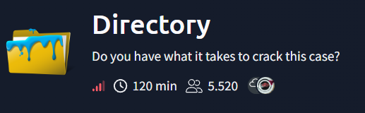
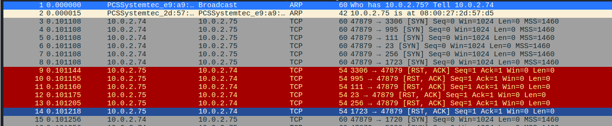
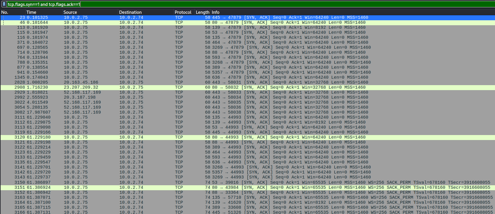
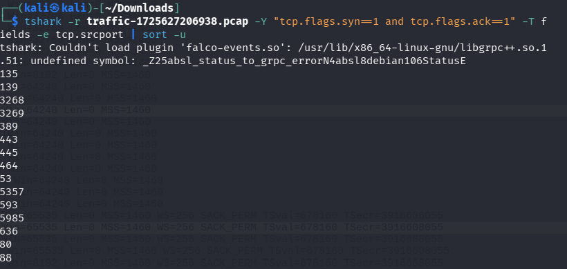
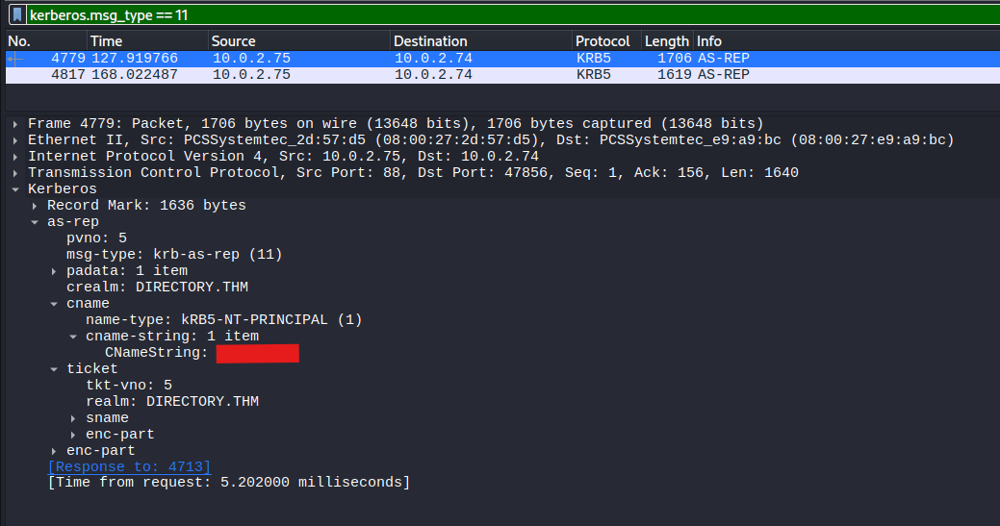
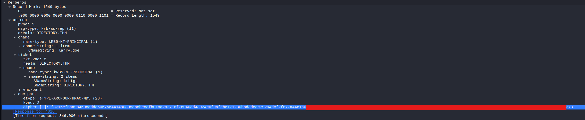
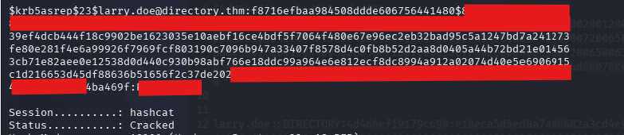
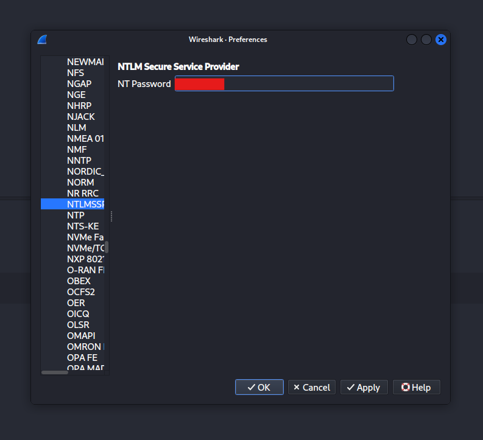
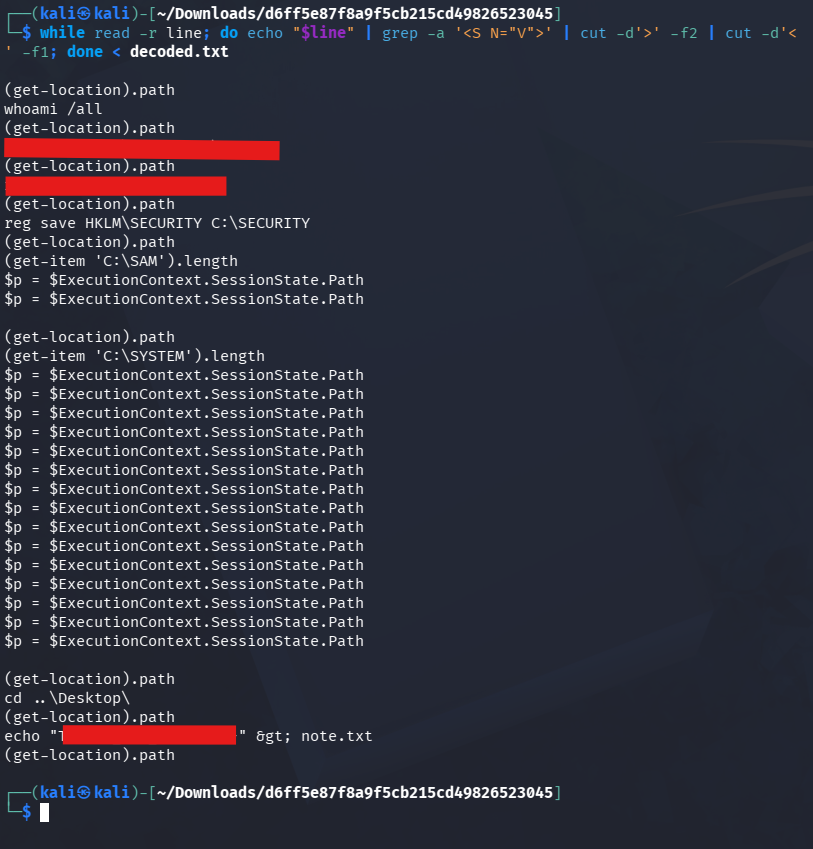

# Directory wirte-up



Welcome to my first ever write-up for a hard difficulty based challenge on tryhackme. Until now, I only tried medium rooms as my hardest, but that will change today! 
In this room, we are tasked to analyse a packet capture from the Directory company which recently feel victim to a threat actor. 
We need to download the files from the room. Since the room suggests to download the file on a dedicated machine, I booted up Kali linux and downloaded the file there

Now let's open Wireshark and begin investigating

Once opened, you can immediately spot port scan activity, based on the fact the target machine replys with a lot of **RST, ACK** flags, indicating that the scanned port is closed



We would now need to filter for packets that indicate a successful port scan result, which would typically be if the target replied with **SYN, ACK** flags. That's because if a port is open, the target machine would try to establish a connection through the TCP three-way handshake on that port.

Following filter would help us with that in wireshark
```txt
tcp.flags.syn==1 and tcp.flags.ack==1
```
> This will filter every packet that contains both a **SYN TCP** flag and **ACK TCP** flag



We have a problem with that though. If you couldn't tell already, we still get a bunch of packets. The reason for that is that we also see legitimate traffic, and multiple port scans could've happened. You could look through all of these packets and list the ones that were found open, however that's inefficient

What we could do instead is to sort out duplicate results with Tshark, which is the CLI variant of wireshark. 



Okay, so now we know which ports were found open. I'd assume judging by the results, that the machine which was being scanned was a domain controller. We see port 88 open which could be kerberos, port 389 and 636 which could be LDAP/LDAPS, and port 445 which could be SMB. 

Based on that, I looked up both smb and kerberos traffic in wireshark since that's usually a way to get initial foothold into an active directory environment. 

When filtering for kerberos, I saw a lot of AS-REP, which might indicate a AS-REP roasting attack. I googled how you could filter for successful AS-REP traffic, which would be `kerberos.msg_type == 11` and found the breached user rather quickly



We know which user got breached, but not what the attacker did. I suspected the threat actor might've abused WinRM, a legitimate windows process for remote administration. We saw that port 5985 was found open, which is usually a port WinRM uses with HTTP. I thought that meant getting the hash quickly, if we just looked at one of the packets to see which hash was passed for the NTLM challenge. 

That's when I realized something though. We found a successful AS-REP packet, and the question is "The threat actor captured a hash from the user in question 2. What are the last **30 characters** of that hash?". Since a successful AS-REP means the KDC (Key distribution center) replied with the user account hash, it should be in the very same packet.
And it indeed was!


> That took me 1 hour to figure out and a long deep dive into "How to find NTLM hashes in wireshark", yet it was in the same packet that whole time...

I tried cracking this hash now. I first of all tried copying the value of the cipher field and just give it to hashcat, but that failed. I looked up the format for a AS-REP hash

```txt
$krb5asrep$23$user@domain.local:hash_data_here
```

Apparently, after the first 32 bits of the hash, you need to add another `$` to the hash, that's why hashcat failed the second time when I tried again.

```bash
hashcat -a 0 -m 18200 hash1.txt /usr/share/wordlists/rockyou.txt
```



I already knew I had to decrypt the WinRM traffic with the hash. However, I never did something like that before, so at first I was kinda overwhelmed. Luckily, there was this medium write-up which explains how to decrypt NTML and Kerberos hashes really well. I linked this blog post in the **references** section at the end of the write-up



With that, I was able to decrypt some packets in wireshark, but that felt really inefficient. I thought there needs to be an easier way to do that, other than using wireshark to decrypt it like the guy in the blog post did.
So what did I do you may ask? I did some good ol' research on how to decrypt WinRM traffic over HTTP. I found the following script: [winrm_decrypt.py](https://gist.github.com/jborean93/d6ff5e87f8a9f5cb215cd49826523045/)

Follow this quick workflow to set everything up required for it to work
```bash
1. git clone https://gist.github.com/jborean93/d6ff5e87f8a9f5cb215cd49826523045/
   
2. sudo apt install python3-pyshark -y (If you dont have it on your machine already)
   
3. python3 winrm_decrypt.py -p 'REDACTED' path/to/traffic.pcap > results.txt
```

Now if you inspect the results, you'll notice two things.
1. First of all, you obviously realize how lengthy the output is and
2. Secondly, you'll notice some big base64 batches here and there

We would need to filter out every base64 junk and decrypt it. Sadly, my shell skills aren't that great yet to automate it, as I haven't really practiced how to filter out regex patterns and stuff with commands like `awk`, `cut` or `grep`
I hope you excuse me for using ChatGPT for this, I've been spending so much time on this CTF and didn't want to spend more time decrypting every base64 batch myself and look for commands.

This is what I did with the help of ChatGPT
1. Get the fields where the base64 encoded strings are in:
   ```bash
   grep -Poz '<rsp:Arguments>\K.*?(?=</rsp:Arguments>)' results.txt > base64_strings.txt
   ```
2. With the extracted base64 strings ready, we try to decrypt them 
```bash
for line in $(cat base64_strings.txt); do echo "$line" | base64 --decode >> decoded.txt; echo >> decoded.txt; done 
```
3. Now all we have to do is to read every field in the XML files that could be a command
```bash
while read -r line; do echo "$line" | grep -a '<S N="V">' | cut -d'>' -f2 | cut -d'<' -f1; done < decoded.txt
```



It looks like the threat actor tried to dump hashes from the SAM hive of the user he first got initial access to. He probably found a hash or credentials which made him domain admin, thus breaching the company. 

## Conclusion

Honestly, I was overwhelmed by this room quite a lot! At first, I felt pretty good, but as soon as all the cryptography stuff came into place, I lost it. I spent A LOT of time really trying to understand it and researching. I overestimated myself, I'd say. I had to search up almost everything as my wireshark skills weren't as good as I thought they'd be. Hence the reason why I even added a **References** section to this write-up. I definitely experienced the imposter syndrome of IT/Cybersecurity. In the end, I even had to use ChatGPT, which annoys me, as I am not quite the fan of AI, personally. 

I learned my lesson, a beginner like me should stick to easier challenges, especially when ones experience is rather small regarding the topic of the room. Im not satisfied with this write-up, as I myself got confused several times during this challenge. I still hope this write-up helped you out to a certain degree! Thanks for reading to the end!

## References
- https://www.freecodecamp.org/news/use-wireshark-filters-to-analyze-network-traffic/#heading-analyzing-security-related-traffic
- https://docs.specterops.io/ghostpack-docs/Rubeus-mdx/commands/roasting/asreproast#hashcat-format-default
- https://medium.com/tenable-techblog/decrypt-encrypted-stub-data-in-wireshark-deb132c076e7
